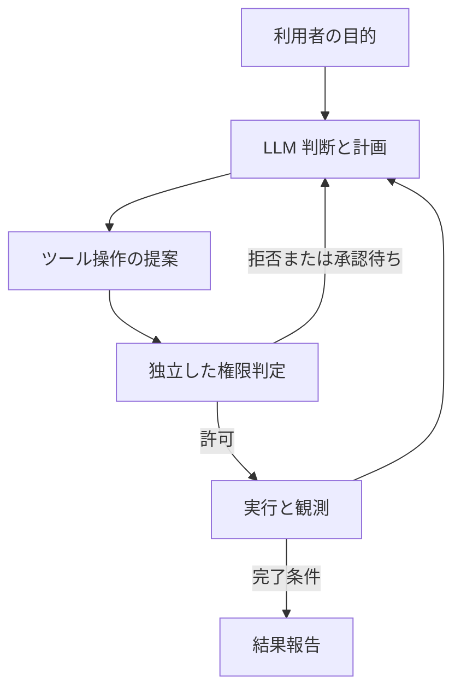
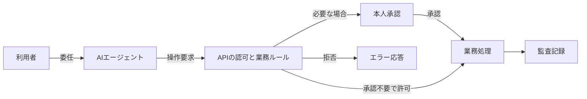
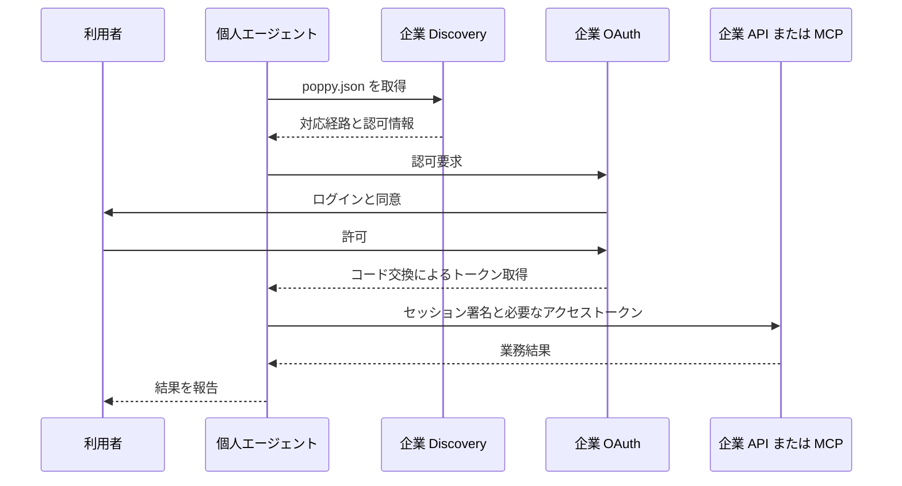
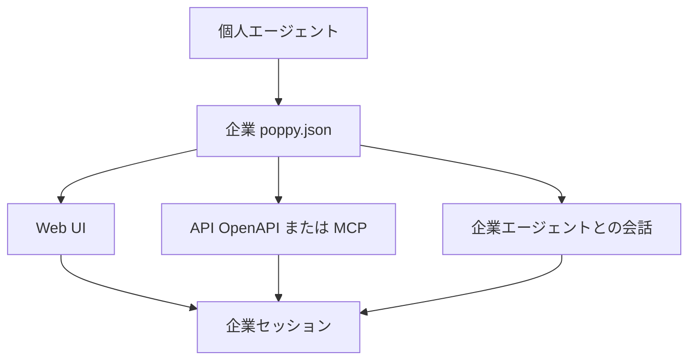
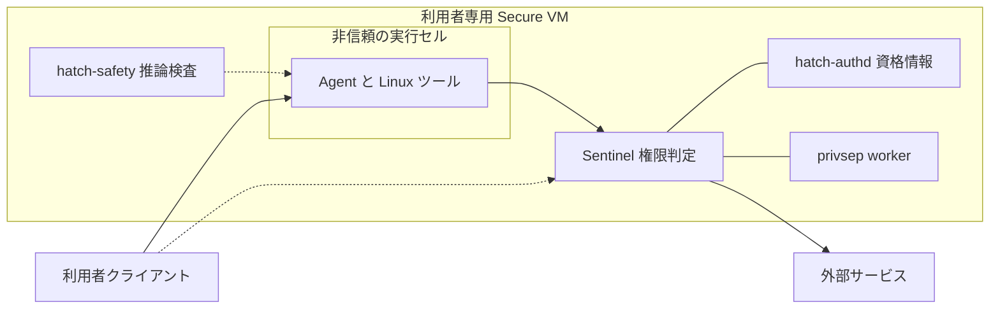

# Meta Muse 技術勉強会 — AIエージェント時代のシステム設計

> 2026年11月25日時点の検討稿。既存のエンジニア版HTML・構成メモとは別の技術深掘り案。発表時間・構成は暫定で、既存スライドへの反映は未実施。

対象は、AIエージェント自体を開発しない人も含むITエンジニア。Museを例に、AIが人間の代理で既存システムを利用する時代に、アプリケーションやAPIの設計がどう変わるかを考える。製品概要と使い方は最小限。2026年11月25日時点。

**中心命題：AIエージェントを作らなくても、AIエージェントに使われるシステムを作ることになるかもしれない。** 発表の焦点は、実行能力を持つAIの登場、権限委譲、企業への接続標準、受け入れ側の設計。モデルの賢さと操作の正当性は分けて考える。

**根拠の区分**：［公式］はMetaの公表内容（実装全体を独立検証した意味ではない）、［仕様］はPoppy 1.0等の規範、［第三者］は外部報告、［分析］は設計上の推論、［未確認］は非公開・未検証事項。

## 1 AIがシステムの利用者になる

### チャットから実行へ

［公式］Museは個人向けのAIエージェントであり、クラウドの実行環境を備える。[1][5] ［分析］応答するだけのAIと異なり、ファイル・ブラウザ・APIを通じて外部の状態を変える。専用実行環境は継続作業や汎用ツール実行のための選択肢。VMはその一つであり、すべてのエージェントに必須という意味ではない。詳しい内部構成は補足に置く。

図1：エージェントが操作を提案し、許可を得て実行・観測する概念図。人間用UIを操作することも、APIを呼ぶこともできる。実行能力を持つことと、実行を許されることは別である。

## 2 AIにどのように権限を委譲するか

### アカウントの認可と個別操作の承認は異なる

例：顧客がAIにECサイトで注文状況を調べてもらう。認可された注文履歴の参照は許しても、注文キャンセルや住所変更は許すとは限らない。OAuthで委譲したアクセス範囲（scope等）と、具体的な操作を許可する条件（対象・金額・有効期限・本人承認等）を分けて設計する。

| 境界 | 問い | システムの役割 |
|---|---|---|
| 認証 | 誰か | 本人・クライアントを識別 |
| 委任 | 何にアクセスできるか | OAuth等で限定的なアクセス権を発行 |
| 業務認可 | この対象にこの操作をしてよいか | サーバーで利用者・対象・状態・権限を検証 |
| 操作承認 | この具体的な変更に同意したか | 必要に応じて内容を提示し、確認を得る |
| 監査 | 誰の依頼で何を実行したか | 実行主体・対象・時刻・結果を記録 |

［公式・第三者］Museは外部操作の許可機構（Sentinel）や資格情報の代理利用を説明している。[1][2] ［分析］モデルの出力をそのまま認可判断にせず、実行時のポリシーを別の強制点で検査することが一般的な教訓。安全性が完全に保証されるわけではない。

図2：受け入れ側から見た権限委譲の概念図。Museの内部構成図ではない。エージェント側で承認済みでも、企業側が必要な業務認可を省略してよいわけではない。

## 3 PoppyはMCPやOAuthと何が違うのか

### 既存規格の責務

| 規格・方式 | 主な責務 | 具体例 |
|---|---|---|
| HTTPS | 通信の保護・サーバー認証 | 接続先との安全な通信 |
| OAuth 2.0 | リソースへのアクセス委任 | 顧客が注文履歴の読み取りを許可 |
| OpenAPI | HTTP APIの機械可読な記述 | 注文照会APIの入出力を定義 |
| MCP | モデルアプリと外部ツール・資源等の接続 | 注文照会ツールを発見・呼び出す |
| A2A | エージェント間のタスク連携 | 問い合わせを別のエージェントへ依頼 |
| Poppy | 企業の発見、代理アクセスの識別、認可と企業セッションを複数経路にまたがって扱う | 顧客の代理で適切な企業接続先を選ぶ |

［仕様］Poppy 1.0はOAuthを利用し、OpenAPI・リモートMCPをAPI経路として扱う。企業のWebサイトや企業エージェントも接続経路になり得る。MCPのトランスポート上のセッションとPoppyの企業セッションは別物。[3] ［分析］MCPがあればツールを公開できるが、企業のどの入口を使うかを事前に個別登録する方式とは異なり、Poppyは企業のドメインを起点に接続先を発見する共通の仕組みを追加する。既存規格の置換ではない。

### 具体例 ECサイトで注文状況を確認する

［仕様］企業の `/.well-known/poppy.json` から対応経路を発見する。エージェントの `client_id` はメタデータを公開するHTTPS URL。未ログインでもセッションを識別できる一方、アカウントへのアクセスにはOAuthトークンを使う。直接サインインはAuthorization Code＋PKCE。企業はスコープを検査し、対応する場合はDPoP等によるトークン束縛を利用する。Poppy-Sessionヘッダーは署名JWTであり、OAuthアクセストークンそのものではない。[3]

図3：アカウントへのアクセスが必要な場合の直接サインインの概念図。PKCEやトークン交換の細部は省略。最初の新規sid付き要求でPoppyセッションが始まるため、独立した開始APIは必須ではない。サインイン不要の公開情報ならOAuthを要求しない設計も可能。[3]

［分析］OAuth同意があることは、すべての送金・購入・データ転送を許可したことを意味しない。企業側の業務制約と、個人エージェント側の実行時承認の両方が必要。

## 4 AIに利用されるシステムをどう設計するか

### 企業側に用意できる三つの接続経路

［公式・仕様］企業はWebサイト、API（OpenAPI/MCP）、企業自身のエージェントを接続先として提供できる。Webのみから開始し、必要に応じてサインインやAPIを追加できる。[3][4]

図4：企業が公開する複数の接続経路。利用できる機能は企業実装・認可・クライアント対応状況によって異なる。Poppyは企業側がエージェントに何を許すか選ぶ仕組みでもある。

| 経路 | 適するタスク | トレードオフ |
|---|---|---|
| Web UI | API未整備の業務、既存画面の再利用 | UI変更・ボット対策・操作誤り |
| API/MCP | 検索、注文照会、定型更新 | スキーマ保守、アクセス管理、機能開発 |
| 企業エージェント | 例外処理、複雑な問い合わせ | 対話遅延、曖昧性、回答の検証 |

### Metaと協力企業が共通規格を採用する理由

［公式］企業が正当な利用者の代理アクセスを識別し、適切な操作経路を提示し、認可を管理できる点が公表されている。また、複数経路の接点を同じ顧客セッションで結び付ける。[4]

［分析］個別コネクタだけではエージェント提供者と企業の組合せごとに接続開発が増えやすい。共通の発見・認可の契約は統合の重複を減らし得る。企業は顧客接点・業務権限を保持し、エージェントはUIの試行錯誤を減らせる可能性がある。一方、標準を実装する企業が増えなければネットワーク効果は弱い。Metaの事業戦略上の動機や実際のコスト削減は仮説であり、定量的な裏付けは未確認。

### スクレイピングとAPI連携の比較

［分析］従来型スクレイピングは導入範囲が広いが変更に弱い。個別API連携は安定しやすいが発見・認可・統合を個別実装する。MCP単独でもツール公開と認可はできるため、Poppyの追加価値は企業単位の複数経路をつなぐ契約にある。Poppyがすべてを置き換えるわけではない。

企業実装時の検討事項：署名・発行者・宛先の検証、スコープの最小化、リプレイ対策、失効、注文等の冪等性、監査ログ、料金・同意表示、プロンプトインジェクション対策。Poppy自体は決済や業務上の正当性を一律に保証しない。企業の採用状況とMuseの対応範囲は仕様と別に確認する。

### 明日から自分の業務システムで意識すること

［分析］Poppyの全面採用が必要という主張ではない。既存アプリの設計を見直すためのチェックリストとして、AIが利用者になると従来の設計原則がなぜ重要になるかを示す。

| 設計項目 | AIを受け入れる際の意味 |
|---|---|
| 発見可能性 | 何ができるか、必要な権限は何かを機械が理解できるようにする |
| 明示的なAPI契約 | 入出力の型、制約、エラー、業務状態を明文化する |
| 最小権限 | 読み取りと更新を区別し、委任範囲・データ範囲を限定する |
| 冪等性 | タイムアウトや再試行で注文等が二重実行されない設計にする |
| 承認 | 重要操作の対象・内容を本人が確認できるようにする |
| 監査可能性 | ユーザー、代理クライアント、操作、承認、結果を相関ID等で追跡する |

具体例（仮想の社内システム）：AIに市場データの取得を許可する際は、閲覧可能な銘柄・項目・期間を制限する。発注APIは別権限とし、注文条件をサーバーで検証して必要な承認を得る。エージェントが存在しなくても有効な設計である。社内規程・データ分類に従うことが前提。

**導入判断**：社内限定の既知ツールならOpenAPIやMCPと既存認証で十分な場合がある。外部の個人エージェントが企業を発見し、複数経路で顧客の代理として利用するならPoppyを検討する理由がある。現時点の採用数・コスト効果・互換性は未確認。

## 発表構成案

本編25分＋質疑5分の仮案。約10枚。実行環境15%・権限管理25%・Poppyと既存規格30%・受け入れ側設計30%を目安とする。既存GitHubの約20分版HTMLへの反映時には圧縮する。

| 時間 | スライド案 | 伝えること |
|---|---|---|
| 0–1分 | 1 表紙・問い | AIエージェントを作らない人にも何が関係するか |
| 1–4分 | 2 AIが利用者になる | 専用実行環境はなぜ必要か、図1 |
| 4–7分 | 3 権限委譲 | OAuth、資格情報、承認の違い |
| 7–10分 | 4 操作を制御する設計 | 読み取り・更新・承認・監査の分離 |
| 10–13分 | 5 既存規格の役割 | OAuth・OpenAPI・MCP・Poppy |
| 13–17分 | 6 Poppyの動き | 注文照会の例、発見・認可・実行、図3 |
| 17–20分 | 7 企業側の選択肢 | Web・API・企業エージェント、図4 |
| 20–23分 | 8 業務アプリの設計 | API契約・冪等性・承認・監査 |
| 23–25分 | 9 結論 | AIに使われるシステムを作るという視点 |
| 25–30分 | 10 質疑 | 規格導入の必要性、責任、セキュリティ |

冒頭：『自社の業務システムに、明日からAIが人間の代理としてアクセスしてきたら、正しい操作と危険な操作を区別できるだろうか？』 結論：『エージェントを作る人だけでなく、エージェントに使われるシステムを作る人にも、新しい設計要件が生まれる可能性がある。』

## 想定質疑応答

**Q. 今のREST APIをMCPやPoppyに全部置き換える必要はある？** A. ない。既存APIを再利用できる。公開対象、発見方法、認可・セッションの共通化が必要な箇所に追加すればよい。

**Q. AIにも人間と同じ画面を使わせれば十分では？** A. UIしかない業務への入口にはなるが、定型的な処理では構造化APIの方が制約や失敗を明示しやすい。どの経路を提供するかは業務の性質と費用による。

**Q. AIによる誤操作の責任は誰が持つ？** A. 技術的にはユーザー、代理エージェント、企業の認可と実行の記録を分離して追跡可能にする。法的・組織的な責任分担は技術規格だけでは決まらない。

**Q. MCPとPoppyのどちらを導入すべき？** A. 閉じた社内ツール接続ならMCPだけでもよい場合がある。企業が外部の個人エージェントに複数の接点を提供するならPoppyの発見・セッション設計が追加価値を持つ。

**Q. Poppyの仕様に従えばMuseで必ず動く？** A. 仕様準拠と製品による受け入れは別。Metaのコネクタ審査や個々の機能の提供状況も確認する。

**Q. 安全性は実証された？** A. 公開設計は安全性を高めるものだが、第三者による迂回報告もある。修正状況、評価の対象版、脅威モデル、仲介の網羅性を分けて確認する。

**Q. 金融機関の社内エージェントに何を応用できる？** A. ［分析］読み取りと発注・送金等の実行権限の分離、資格情報の代理利用、承認画面をモデルの外に置く、許可された操作の監査など。実際の導入は社内規程・データ分類・システムリスク評価に従う。

## 補足 実行基盤の詳細

### Secure VMと信頼境界

［公式・第三者］利用者単位のクラウドVMにエージェント実行用コンテナを置き、同じVM内のコンテナ外に権限・資格情報・安全性を扱うコンポーネントを分離する。Hatchは内部名称として資料に登場する。Sentinelはコネクタ操作と外向き通信の許可を担う設計。hatch-authdは資格情報の保護、privsep workerは限定権限でのコネクタ処理、hatch-safetyは推論トラフィックの検査を担うと説明される。[1][2]

補足図A：公開資料に基づく概念図。VMの境界とコンテナの境界を区別する。外部サービスへのすべての経路が実際に仲介されるという証明ではない。推論基盤・永続化・テレメトリなどは簡略化。

### Sentinelなどのセキュリティ機構

| 機構 | 何を守るか | 設計上の限界 |
|---|---|---|
| Sentinel | 外部操作の許可をエージェントから分離 | 仲介漏れ・判定誤り・実装不備 |
| Credential Surrogation | モデルや一般ツールに本物のトークンを渡さず、許可された経路で利用 | 正規の権限を悪用する操作は別途防止が必要 |
| Tainted Egress | 利用者データを読んだプロセスの外向き通信を追加審査 | ラベルの伝播漏れ、過剰判定、暗黙フローなどの検討が必要 |

［公式・第三者］eBPFとLinuxのセキュリティフックによるデータアクセス追跡を利用し、機密データを扱った処理の自動許可を制限する設計が説明される。[1][2] ［分析］eBPF自体が情報漏洩を防ぐのではない。監視対象、追跡粒度、仲介点、ポリシーが組み合わさって初めて制御となる。すべての情報フローの数学的保証は確認できない。

具体例（概念）：メールを読んだエージェントが、Webページに書かれた誘導文に従って外部へのデータ送信を提案した場合、モデルの拒否能力だけに頼らず、別の許可機構が送信を審査する。資格情報を持たないことと、データ送信を許可されないことは別の性質。

### VMとコンテナの使い分け

［公式］Metaは私的データへのアクセス、信頼できない外部入力、外部通信という組合せを脅威として扱う。[1] ［分析］VMは利用者間の隔離境界、コンテナは利用者内の権限分離とプロセス管理に適する。任意コードの自由度を維持しつつ、モデルの判断からセキュリティ上の強制を切り離せる。ただし採用理由の全てや代替案の社内比較は公開確認できない。

| 代替方式 | 利点 | 弱点・用途 |
|---|---|---|
| API限定のFunction Calling | 操作集合が狭く制御容易 | 未対応業務・サイトに弱い |
| 共有ホスト上のコンテナのみ | 起動・運用コストを抑えやすい | 共有カーネル境界への依存 |
| 利用者専用VM＋内部コンテナ | 複数の信頼境界、汎用Linux実行 | VM維持、パッチ、監視、資源効率 |
| 操作ごとの使い捨てVM | 状態残留を抑制しやすい | 永続作業、起動時間、状態移送の負担 |
| ローカル端末上のエージェント | クラウド常駐資源の節約、端末内処理の選択肢 | 端末稼働・更新・ユーザーデータ隔離 |

［分析］比較は定性的であり、同一条件での性能や費用ベンチマークではない。専用VMの費用、利用者あたり割当量、冷起動時間、許可遅延、誤検知率は未確認。

### 安全性の検証と残余リスク

［第三者］Cloud Security Allianceは2026年11月、MuseのSentinelによる外向き通信制御に対する迂回の研究を紹介した。[2] これは公開上の設計意図と実装の強制力を区別する好例。現行版への影響や修正の完了はここでは未確認。発表では攻撃手順ではなく、全経路の仲介、最小権限、依存ソフト更新、隔離境界の検証という原則を論じる。『絶対に漏洩しない』という表現は避ける。

### 実行基盤に関する補足質疑

**Q. なぜDockerだけでは不十分？** A. コンテナはホストカーネルを共有する。VMを追加すれば異なる隔離境界を設けられるが、VMも万能ではない。専用VMは利用者間隔離、内部コンテナは権限分離という設計上の役割を持つ。

**Q. Sentinelは別のLLMなのか？** A. 別個の許可機構として説明される。判定ロジック全体が純粋なルールか、どこでモデルを併用するかは公開資料の範囲で断定しない。強制点と判断器を区別する。

**Q. eBPFで機密情報を完全追跡できる？** A. できるとは確認されていない。追跡対象、粒度、カーネル境界、データ変換、暗黙フローが重要。テイントは追加審査のための信号。

**Q. OAuthがあればSentinelはいらない？** A. OAuthは企業側リソースへの委任。Sentinelはエージェント実行側の具体的な操作を制御する。別の境界で相互補完する。

## 参考文献と確認事項

[1] Meta, [How We Built Safety Into Muse](https://muse.ai/blog/security-and-safety-for-ai-agents-our-approach-with-muse), 2026-09-08。実行・安全性設計の一次資料。公式ページの一部本文は再取得に失敗したため、詳細は[2]の引用・説明と照合した。発表前に公式構成図と詳細を再確認する。

[2] Cloud Security Alliance, [Breaking the Agent’s Egress Gate: Lessons from the Muse Sentinel Bypass](https://labs.cloudsecurityalliance.org/research/csa-research-note-meta-muse-sentinel-bypass-agent-egress-202/), 2026年11月。独立した検証報告の解説。現行版への影響は未確認。

[3] [Personal Agent Protocol specification 1.0](https://personalagentprotocol.org/docs/1.0/spec)。特に§3 Discovery、§4 OAuth、§5 Sessions、§7 APIs、§8 Conversations。仕様上の要求とMuseへの実装済み機能を混同しない。

[4] Meta, [More Ways for Muse to Work With Businesses](https://muse.ai/blog/poppy-personal-agent-protocol), 2026年11月。企業向け接続とMetaが公表する採用目的。

[5] Meta, [How We Designed Muse](https://muse.ai/blog/how-we-designed-muse), 2026-09-08。製品設計の背景。

追加学習用の規格（詳細は発表前に確認）：[OAuth 2.0 RFC 6749](https://www.rfc-editor.org/rfc/rfc6749)、[OAuth Security BCP RFC 9700](https://www.rfc-editor.org/rfc/rfc9700)、[PKCE RFC 7636](https://www.rfc-editor.org/rfc/rfc7636)、[DPoP RFC 9449](https://www.rfc-editor.org/rfc/rfc9449)、[MCP 2025-06-18](https://modelcontextprotocol.io/specification/2025-06-18)、[OpenAPI 3.1](https://spec.openapis.org/oas/v3.1.0)。

### 発表前チェックリスト

- [ ] 公式のSecure VM構成図と各コンポーネントの責務を原文で再確認する。

- [ ] Sentinel迂回報告に対するMetaの修正・影響範囲の最新公表を確認する。

- [ ] Poppy仕様の最新版とMuseが実際に提供する経路を確認する。

- [ ] 概念図と実装図の差を明示する。

- [ ] 性能・費用・安全性について実測値がない箇所は定性的比較に留める。

- [ ] 30分の仮構成を実際の持ち時間に調整し、既存HTML資料への反映範囲を決める。
