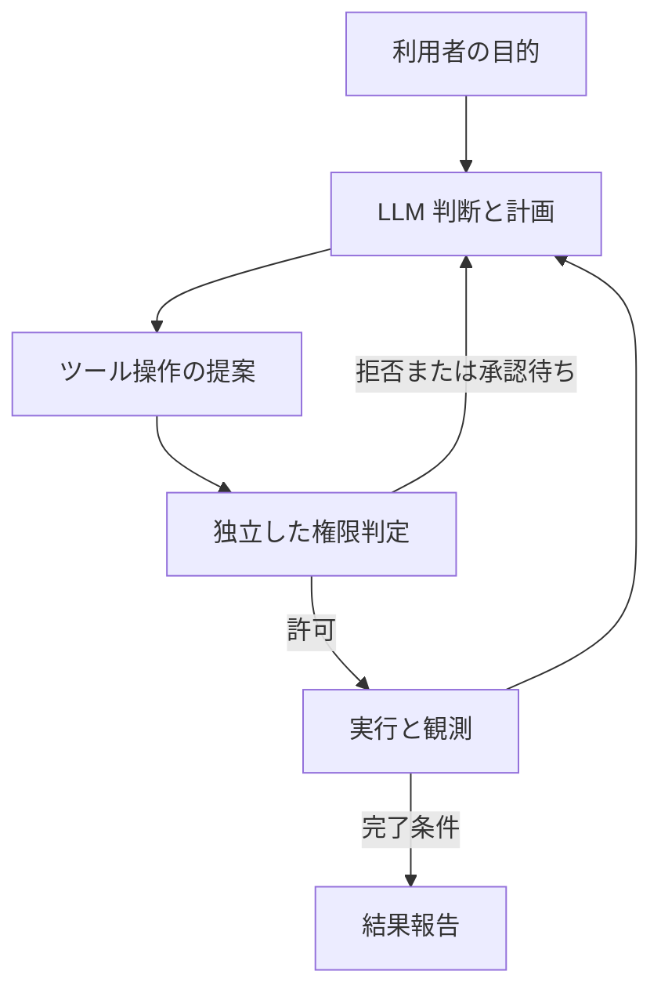
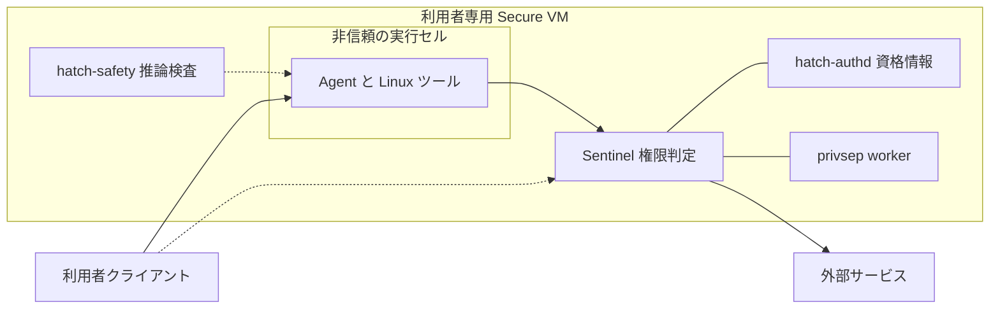
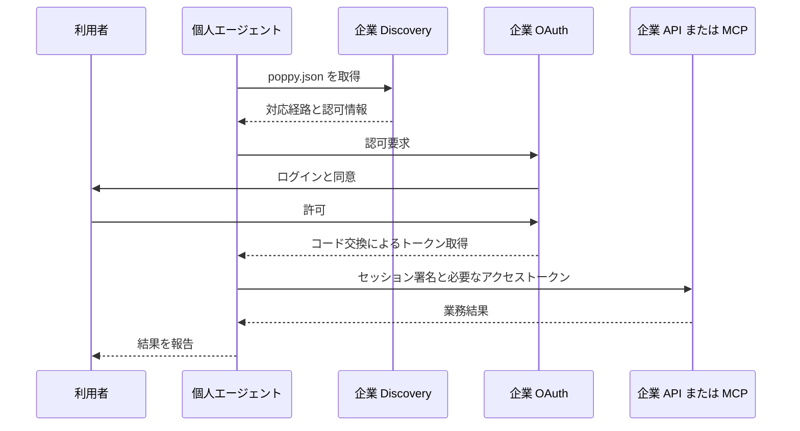
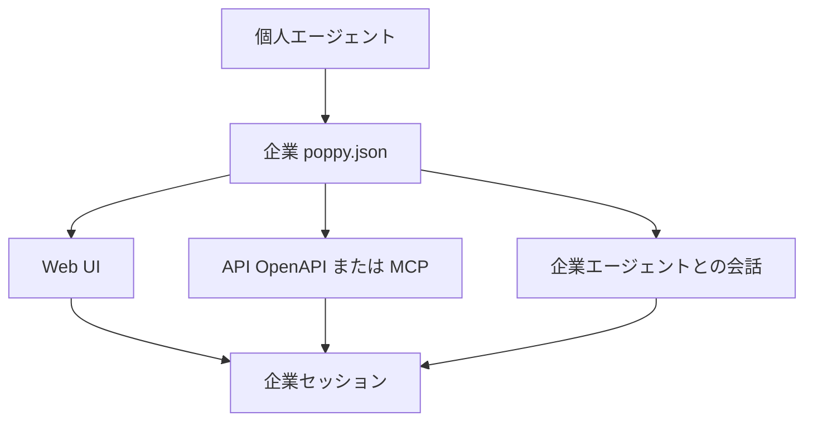

# Meta Muse 技術勉強会 — 発表準備・技術深掘り案

> 2026年11月25日時点の検討稿。既存のエンジニア版HTML・構成メモとは別の技術深掘り案。発表時間・構成は暫定で、既存スライドへの反映は未実施。

対象はITエンジニア。製品紹介ではなく、任意コードを実行する個人エージェントをどう制御し、企業システムとどう接続するかを学ぶ。前回の項目1（Hatch・Secure VM・Agent Loop）、3（Poppy・MCP・OAuth）、6（Poppyによる企業接続）を扱う。項目3は規格の責務、項目6は企業側の設計・普及に分ける。2026年11月25日時点。

**中心命題：モデルの判断能力と、実行権限を分離する。** 内部では実行環境と許可機構を分離し、外部では企業が提供する操作・認可・セッションの境界を明示する。これは設計上の読み解きであり、安全性の保証ではない。

**根拠の区分**：［公式］はMetaの公表内容（実装全体を独立検証した意味ではない）、［仕様］はPoppy 1.0等の規範、［第三者］は外部報告、［分析］は設計上の推論、［未確認］は非公開・未検証事項。

# テーマ1 AIの実行基盤 Hatch Secure VM Agent Loop

## 1.1 LLMから実行システムへ

［分析］Agent Loopは、目的→計画→ツール実行→観測→再計画→終了の反復として理解する。単一の推論APIと異なり、ファイル、プロセス、ブラウザ、外部サービスの状態が変化する。必要なのはモデル性能だけでなく、権限、状態保存、再試行、終了条件、監査、外部副作用の管理。Muse固有のループ実装やスケジューラ詳細は未確認。

図1：概念的なAgent Loop。Metaの内部処理順序を再現したものではない。拒否・承認待ちを区別し、外部操作の再試行には重複実行防止が必要。

## 1.2 Secure VMと信頼境界

［公式・第三者］利用者単位のクラウドVMにエージェント実行用コンテナを置き、同じVM内のコンテナ外に権限・資格情報・安全性を扱うコンポーネントを分離する。Hatchは内部名称として資料に登場する。Sentinelはコネクタ操作と外向き通信の許可を担う設計。hatch-authdは資格情報の保護、privsep workerは限定権限でのコネクタ処理、hatch-safetyは推論トラフィックの検査を担うと説明される。[1][2]

図2：公開資料に基づく概念図。VMの境界とコンテナの境界を区別する。外部サービスへのすべての経路が実際に仲介されるという証明ではない。推論基盤・永続化・テレメトリなどは簡略化。

## 1.3 セキュリティの三つの仕組み

| 機構 | 何を守るか | 設計上の限界 |
|---|---|---|
| Sentinel | 外部操作の許可をエージェントから分離 | 仲介漏れ・判定誤り・実装不備 |
| Credential Surrogation | モデルや一般ツールに本物のトークンを渡さず、許可された経路で利用 | 正規の権限を悪用する操作は別途防止が必要 |
| Tainted Egress | 利用者データを読んだプロセスの外向き通信を追加審査 | ラベルの伝播漏れ、過剰判定、暗黙フローなどの検討が必要 |

［公式・第三者］eBPFとLinuxのセキュリティフックによるデータアクセス追跡を利用し、機密データを扱った処理の自動許可を制限する設計が説明される。[1][2] ［分析］eBPF自体が情報漏洩を防ぐのではない。監視対象、追跡粒度、仲介点、ポリシーが組み合わさって初めて制御となる。すべての情報フローの数学的保証は確認できない。

具体例（概念）：メールを読んだエージェントが、Webページに書かれた誘導文に従って外部へのデータ送信を提案した場合、モデルの拒否能力だけに頼らず、別の許可機構が送信を審査する。資格情報を持たないことと、データ送信を許可されないことは別の性質。

## 1.4 なぜVMとコンテナを組み合わせるのか

［公式］Metaは私的データへのアクセス、信頼できない外部入力、外部通信という組合せを脅威として扱う。[1] ［分析］VMは利用者間の隔離境界、コンテナは利用者内の権限分離とプロセス管理に適する。任意コードの自由度を維持しつつ、モデルの判断からセキュリティ上の強制を切り離せる。ただし採用理由の全てや代替案の社内比較は公開確認できない。

| 代替方式 | 利点 | 弱点・用途 |
|---|---|---|
| API限定のFunction Calling | 操作集合が狭く制御容易 | 未対応業務・サイトに弱い |
| 共有ホスト上のコンテナのみ | 起動・運用コストを抑えやすい | 共有カーネル境界への依存 |
| 利用者専用VM＋内部コンテナ | 複数の信頼境界、汎用Linux実行 | VM維持、パッチ、監視、資源効率 |
| 操作ごとの使い捨てVM | 状態残留を抑制しやすい | 永続作業、起動時間、状態移送の負担 |
| ローカル端末上のエージェント | クラウド常駐資源の節約、端末内処理の選択肢 | 端末稼働・更新・ユーザーデータ隔離 |

［分析］比較は定性的であり、同一条件での性能や費用ベンチマークではない。専用VMの費用、利用者あたり割当量、冷起動時間、許可遅延、誤検知率は未確認。

## 1.5 安全性の反証と残余リスク

［第三者］Cloud Security Allianceは2026年11月、MuseのSentinelによる外向き通信制御に対する迂回の研究を紹介した。[2] これは公開上の設計意図と実装の強制力を区別する好例。現行版への影響や修正の完了はここでは未確認。発表では攻撃手順ではなく、全経路の仲介、最小権限、依存ソフト更新、隔離境界の検証という原則を論じる。『絶対に漏洩しない』という表現は避ける。

# テーマ3 AI時代のWeb規格 Poppy MCP OAuth

## 3.1 規格は競合ではなく責務の異なるレイヤー

| 規格・方式 | 主な責務 | 単独では解決しないこと |
|---|---|---|
| HTTPS | 通信の保護と相手の認証 | 業務操作の意味・委任 |
| OAuth 2.0 | ユーザーからクライアントへのアクセス委任 | 各操作の業務上の妥当性 |
| OpenAPI | HTTP APIの機械可読な記述 | 企業横断の発見・一貫した利用者セッション |
| MCP | モデルアプリと外部ツール・資源等の接続 | Web・企業エージェントを横断する企業セッション |
| A2A | エージェント間のタスク連携 | 消費者向け企業接続全体の統一契約 |
| Poppy | 企業の発見、個人エージェントの識別、認可・セッションを複数経路で統合 | 個別APIの業務定義、実行環境の安全性 |

［仕様］Poppy 1.0は標準OAuthを用い、OpenAPIとリモートMCPをAPI経路として記述できる。企業との会話やWeb利用も同じセッション概念で扱う。MCPのトランスポート上のセッションとPoppyの企業セッションは異なる。[3]

## 3.2 認可と識別の流れ

［仕様］企業の `/.well-known/poppy.json` から対応経路を発見する。エージェントの `client_id` はメタデータを公開するHTTPS URL。未ログインでもセッションを識別できる一方、アカウントへのアクセスにはOAuthトークンを使う。直接サインインはAuthorization Code＋PKCE。企業はスコープを検査し、対応する場合はDPoP等によるトークン束縛を利用する。Poppy-Sessionヘッダーは署名JWTであり、OAuthアクセストークンそのものではない。[3]

図3：直接サインインを使う概念的なフロー。PKCE検証や署名検証、トークン発行の往復は省略。Poppy 1.0では新規sidを使う最初の要求がセッションを開始するため、独立した開始APIが必須とは説明しない。

［分析］OAuth同意があることは、すべての送金・購入・データ転送を許可したことを意味しない。企業側の業務制約と、個人エージェント側の実行時承認の両方が必要。

# テーマ6 Poppyと企業が公開するエージェント向けWeb

## 6.1 三つの接続経路

［公式・仕様］企業はWebサイト、API（OpenAPI/MCP）、企業自身のエージェントを接続先として提供できる。Webのみから開始し、必要に応じてサインインやAPIを追加できる。[3][4]

図4：接続経路とセッションの関係。各経路の実際の操作可能範囲は企業の実装次第。

| 経路 | 適するタスク | トレードオフ |
|---|---|---|
| Web UI | API未整備の業務、既存画面の再利用 | UI変更・ボット対策・操作誤り |
| API/MCP | 検索、注文照会、定型更新 | スキーマ保守、アクセス管理、機能開発 |
| 企業エージェント | 例外処理、複雑な問い合わせ | 対話遅延、曖昧性、回答の検証 |

## 6.2 Metaが採用する理由

［公式］企業が正当な利用者の代理アクセスを識別し、適切な操作経路を提示し、認可を管理できる点が公表されている。また、複数経路の接点を同じ顧客セッションで結び付ける。[4]

［分析］個別コネクタだけではエージェント提供者と企業の組合せごとに接続開発が増えやすい。共通の発見・認可の契約は統合の重複を減らし得る。企業は顧客接点・業務権限を保持し、エージェントはUIの試行錯誤を減らせる可能性がある。一方、標準を実装する企業が増えなければネットワーク効果は弱い。Metaの事業戦略上の動機や実際のコスト削減は仮説であり、定量的な裏付けは未確認。

## 6.3 比較と設計課題

［分析］従来型スクレイピングは導入範囲が広いが変更に弱い。個別API連携は安定しやすいが発見・認可・統合を個別実装する。MCP単独でもツール公開と認可はできるため、Poppyの追加価値は企業単位の複数経路をつなぐ契約にある。Poppyがすべてを置き換えるわけではない。

企業実装時の検討事項：署名・発行者・宛先の検証、スコープの最小化、リプレイ対策、失効、注文等の冪等性、監査ログ、料金・同意表示、プロンプトインジェクション対策。Poppy自体は決済や業務上の正当性を一律に保証しない。企業の採用状況とMuseの対応範囲は仕様と別に確認する。

# 発表構成案

仮定：30分（発表25分＋質疑5分）。技術者向け。スライド10枚程度。

| 時間 | 内容 | 伝える要点 |
|---|---|---|
| 0–2分 | 課題提起 | 賢いLLMに権限を与えると何が変わるか |
| 2–5分 | Agent Loop | 推論と副作用の違い、図1 |
| 5–10分 | VMとコンテナ | 信頼境界、図2、代替方式 |
| 10–14分 | Sentinel等 | 権限分離、資格情報、テイント、第三者報告 |
| 14–19分 | OAuth・MCP・Poppy | レイヤーと認可、図3 |
| 19–23分 | Poppyの企業連携 | 三経路、図4、普及と実装負担 |
| 23–25分 | 総括 | 内部の実行権限と外部の業務権限の二重境界 |
| 25–30分 | 質疑 | 代替方式、安全性、企業導入 |

冒頭の問い：『メールも読めて、任意コードも動かせて、WebにアクセスできるAIに、何を信頼すればよいか？』 終盤は『AIの判断を信頼することと、AIに何でも許可することは別』で締める。

# 想定質疑応答

**Q. なぜDockerだけでは不十分？** A. コンテナはホストカーネルを共有する。VMを追加すれば異なる隔離境界を設けられるが、VMも万能ではない。専用VMは利用者間隔離、内部コンテナは権限分離という設計上の役割を持つ。

**Q. Sentinelは別のLLMなのか？** A. 別個の許可機構として説明される。判定ロジック全体が純粋なルールか、どこでモデルを併用するかは公開資料の範囲で断定しない。強制点と判断器を区別する。

**Q. eBPFで機密情報を完全追跡できる？** A. できるとは確認されていない。追跡対象、粒度、カーネル境界、データ変換、暗黙フローが重要。テイントは追加審査のための信号。

**Q. OAuthがあればSentinelはいらない？** A. OAuthは企業側リソースへの委任。Sentinelはエージェント実行側の具体的な操作を制御する。別の境界で相互補完する。

**Q. MCPとPoppyのどちらを導入すべき？** A. 閉じた社内ツール接続ならMCPだけでもよい場合がある。企業が外部の個人エージェントに複数の接点を提供するならPoppyの発見・セッション設計が追加価値を持つ。

**Q. Poppyの仕様に従えばMuseで必ず動く？** A. 仕様準拠と製品による受け入れは別。Metaのコネクタ審査や個々の機能の提供状況も確認する。

**Q. 安全性は実証された？** A. 公開設計は安全性を高めるものだが、第三者による迂回報告もある。修正状況、評価の対象版、脅威モデル、仲介の網羅性を分けて確認する。

**Q. 金融機関の社内エージェントに何を応用できる？** A. ［分析］読み取りと発注・送金等の実行権限の分離、資格情報の代理利用、承認画面をモデルの外に置く、許可された操作の監査など。実際の導入は社内規程・データ分類・システムリスク評価に従う。

# 参考文献と確認事項

[1] Meta, [How We Built Safety Into Muse](https://muse.ai/blog/security-and-safety-for-ai-agents-our-approach-with-muse), 2026-09-08。実行・安全性設計の一次資料。公式ページの一部本文は再取得に失敗したため、詳細は[2]の引用・説明と照合した。発表前に公式構成図と詳細を再確認する。

[2] Cloud Security Alliance, [Breaking the Agent’s Egress Gate: Lessons from the Muse Sentinel Bypass](https://labs.cloudsecurityalliance.org/research/csa-research-note-meta-muse-sentinel-bypass-agent-egress-202/), 2026年11月。独立した検証報告の解説。現行版への影響は未確認。

[3] [Personal Agent Protocol specification 1.0](https://personalagentprotocol.org/docs/1.0/spec)。特に§3 Discovery、§4 OAuth、§5 Sessions、§7 APIs、§8 Conversations。仕様上の要求とMuseへの実装済み機能を混同しない。

[4] Meta, [More Ways for Muse to Work With Businesses](https://muse.ai/blog/poppy-personal-agent-protocol), 2026年11月。企業向け接続とMetaが公表する採用目的。

[5] Meta, [How We Designed Muse](https://muse.ai/blog/how-we-designed-muse), 2026-09-08。製品設計の背景。

追加学習用の規格（詳細は発表前に確認）：[OAuth 2.0 RFC 6749](https://www.rfc-editor.org/rfc/rfc6749)、[OAuth Security BCP RFC 9700](https://www.rfc-editor.org/rfc/rfc9700)、[PKCE RFC 7636](https://www.rfc-editor.org/rfc/rfc7636)、[DPoP RFC 9449](https://www.rfc-editor.org/rfc/rfc9449)、[MCP 2025-06-18](https://modelcontextprotocol.io/specification/2025-06-18)、[OpenAPI 3.1](https://spec.openapis.org/oas/v3.1.0)。

## 発表前チェックリスト

- [ ] 公式のSecure VM構成図と各コンポーネントの責務を原文で再確認する。

- [ ] Sentinel迂回報告に対するMetaの修正・影響範囲の最新公表を確認する。

- [ ] Poppy仕様の最新版とMuseが実際に提供する経路を確認する。

- [ ] 概念図と実装図の差を明示する。

- [ ] 性能・費用・安全性について実測値がない箇所は定性的比較に留める。

- [ ] 30分の仮構成を実際の持ち時間に調整する。
